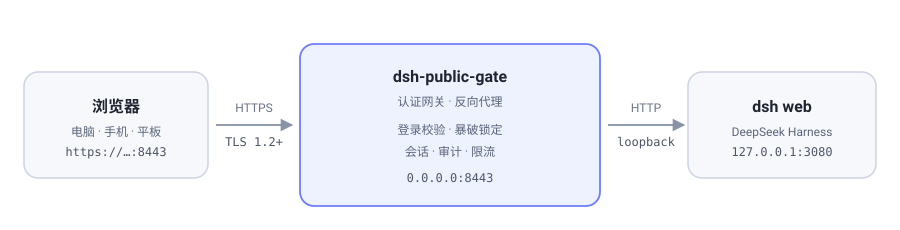

<p align="center">
  
</p>

<h1 align="center">dsh-public-gate</h1>

<p align="center">
  把 <b>DeepSeek Harness</b> 安全暴露到公网的认证网关<br>
  账号密码 / TOTP / 邮箱验证码 · 暴破防护 · 硬化反向代理 · <b>dsh 自身永远只监听 127.0.0.1</b>
</p>

<p align="center">
  <a href="https://github.com/hchao3335-maker/dsh-public-gate/actions/workflows/ci.yml"></a>
  <a href="LICENSE"></a>
  
  
  
  <a href="https://github.com/hchao3335-maker/dsh-public-gate/stargazers"></a>
  <a href="https://github.com/hchao3335-maker/dsh-public-gate/commits/main"></a>
</p>

<p align="center">
  <a href="#features"> 特性</a> ·
  <a href="#sec-1"> 安全模型</a> ·
  <a href="#sec-2"> 登录方式</a> ·
  <a href="#sec-3"> 安装</a> ·
  <a href="#sec-5"> 设置页</a> ·
  <a href="#sec-8"> 测试</a> ·
  <a href="#contributing"> 贡献</a>
</p>

> **本项目取代旧项目 [dsh-lan-gate](https://github.com/hchao3335-maker/dsh-lan-gate)**（局域网访问版，已停止维护）。

> 关键点：**dsh 本身仍然只监听 `127.0.0.1`**。插件不会去改 dsh 的绑定地址（上游源码明确拒绝 `0.0.0.0`，因为 UI 可以在宿主机上执行代码）。公网上只开插件自己的 HTTPS 端口，认证通过后才转发到本机 dsh。网关挂了或配错了，公网上什么都访问不到——**fail closed**。

---

<a id="features"></a>
##  特性

| | 能力 | 说明 |
| :--: | --- | --- |
|  | **dsh 不暴露** | 上游固定 `127.0.0.1`，公网只开网关端口；网关挂了/配错就什么都进不来 |
|  | **四种登录组合** | 密码 / 密码 + TOTP / 仅邮箱验证码 / 密码 + 邮箱验证码，随时切换 |
|  | **scrypt 口令** | 内存硬哈希 + 每账号随机盐 + 常量时间比较，拖库也难还原 |
|  | **邮箱验证码** | 6 位、10 分钟、一次性、5 次作废；同 IP 30 秒重发间隔 + 每小时配额 |
|  | **抗暴破** | 递增延迟 + 分级锁定（1 分钟 / 15 分钟 / 24 小时）+ 全站熔断 |
|  | **会话安全** | 256 位随机 ID、HttpOnly + Secure + SameSite=Strict、空闲/绝对双超时、服务端可吊销 |
|  | **安全响应头** | CSP、HSTS、`X-Frame-Options: DENY`、`nosniff`、`no-referrer` |
|  | **设置面板** | dsh 设置页内改登录方式、密码、收件箱、有效期，一键发测试邮件 |
|  | **审计日志** | JSONL + syslog 双写，可直接接 fail2ban |
|  | **零依赖** | 只用 Node 内置模块，没有第三方包 |

---

<p align="center">
  
</p>

---

<a id="sec-1"></a>
##  1. 安全模型

### 防护了什么

| 威胁 | 措施 |
| --- | --- |
| 口令被离线爆破（拖库） | 口令用 **scrypt**（N=32768, r=8, p=1，每账号随机盐）存储，不是 SHA256；哈希泄露也难以离线还原 |
| 在线暴破 / 撞库 | 失败递增延迟（200ms→4s）+ 分级锁定（5 次 1 分钟 / 10 次 15 分钟 / 15 次 24 小时）+ 全局熔断（10 分钟内全站 300 次失败→暂停 5 分钟） |
| 口令泄露后单点失守 | **二次验证**：邮箱验证码（默认）或 **TOTP**（RFC 6238）。未配置任何二次因子时插件拒绝启动，除非显式设置 `allowPasswordOnly: true` |
| 验证码被猜 / 被刷 | 验证码 6 位、10 分钟过期、**一次性**、最多 5 次尝试；发送频率限制（同 IP 30 秒一次、每小时 10 次，全站每小时 120 次） |
| 邮箱被当成爆破入口 | 发送接口带 CSRF token；`password+code` 模式下没有进行中的登录不允许触发发送，避免被用来轰炸邮箱 |
| 会话劫持 / 固定 | 256 位随机会话 ID，服务端存储；`HttpOnly` + `Secure` + `SameSite=Strict`；空闲 + 绝对双重超时；登录后重新签发；登出即服务端销毁 |
| CSRF | 登录/登出/TOTP 表单都带一次性 CSRF token，与 cookie 常量时间比对 |
| XSS | 登录页 **零 JavaScript**，CSP 为 `default-src 'none'; script-src 无` |
| 点击劫持 / 嗅探 | `X-Frame-Options: DENY`、`Referrer-Policy: no-referrer`、`nosniff`、HSTS |
| 时序侧信道 | 用户名比对、口令比对、TOTP 比对全部常量时间；用户名错误也照样跑一遍 scrypt（无法用响应时间区分"用户不存在"） |
| 慢速攻击 / 资源耗尽 | `headersTimeout` / `requestTimeout` / `keepAliveTimeout` / `maxConnections` 限制；登录请求体上限 8KB；WebSocket 隧道数上限 |
| 凭据泄露给浏览器 | 网关自己持有 dsh 的内部 cookie，**上游响应的 `Set-Cookie` 一律剥离**，客户端永远拿不到 dsh 凭据 |
| 绕过网关直连 dsh | dsh 只监听 loopback，公网无法直连 |

### 没有防护什么（务必知道）

- **这是 root 级远程执行入口。** 认证通过 = 对方可以在服务器上跑任意命令。请只用强口令 + TOTP，并尽量配合 IP 白名单。
- **自签名证书**：首次启动若没有真证书，会用 openssl 生成本地自签名证书。传输是加密的，但浏览器会告警，且**不能防主动 MITM**。建议配好域名后用 Let's Encrypt（见 §5）。
- TOTP 密钥存在服务器 `config.json`（0600）。服务器被完全攻陷时，攻击者可以同时拿到哈希和 TOTP 密钥——但那时候已经不需要登录了。
- **邮箱验证码模式的信任边界是你的邮箱**。`code-only` 模式下，谁能读 `email.to` 里的邮箱，谁就能登录这台服务器。请给该邮箱开启二次验证并设置强口令；需要更稳的话改用 `--mode password+code`，把口令加回来。
- 邮件走明文 SMTP 时验证码可被链路嗅探；请务必使用 465（隐式 TLS）或 587（STARTTLS），本插件默认走 465 并校验证书。

---

<a id="sec-2"></a>
##  2. 登录方式（四种组合）

四种组合**代码里全都在**，用哪个只看配置：

| 组合 | 登录页看到什么 | 配置 | 强度 |
| --- | --- | --- | --- |
| **密码 + 邮箱验证码**（推荐） | 用户名 + 密码 → 邮箱 6 位码 | `email.enabled=true` + `email.mode=password+code` | 最高 |
| **仅邮箱验证码**（最省事） | 只填邮箱 6 位码 | `email.enabled=true` + `email.mode=code-only` | 中：邮箱被盗即失守 |
| **密码 + TOTP** | 用户名 + 密码 → 认证器 6 位码 | `security.totp.secret` 非空且 `email.enabled=false` | 高 |
| **仅密码** | 用户名 + 密码 | 两者都不配 + `security.allowPasswordOnly=true` | 最低 |

优先级：`email.enabled=true` > 有 TOTP 密钥 > 仅密码。
开了邮箱验证码后 TOTP 密钥会被**暂时忽略但保留**，关掉邮箱就自动恢复。

切换方式二选一：

```bash
# 1) 命令行（改完重启 dsh）
node bin/gate-tool.mjs set-email --mode password+code --user ... --pass ... --to ...
node bin/gate-tool.mjs show        # 看 second factor 是 email / totp / none

# 2) dsh 设置面板 → 公网访问 → 登录方式（即时生效，不用重启）
```

> `init` 生成的口令哈希会一直保留，切到「仅邮箱验证码」时它只是不参与校验，随时切回来即可。
> 切到「密码 + 邮箱验证码」前必须先有密码，否则页面会拒绝并提示。
<a id="sec-3"></a>
##  3. 安装

### 方式一：在 DSH 里直接装（推荐）

打开 **设置 → 插件 → 添加插件**，粘贴仓库地址即可：

```
https://github.com/hchao3335-maker/dsh-public-gate
```

命令行等价：

```bash
dsh plugin --profile web add github:hchao3335-maker/dsh-public-gate
```

因为 `package.json` 里声明了 `dsh.bundle.patch`，装完会**自动注册成 profile 层**，不需要手改 `cordis.patch.yml`。

> **前置条件：机器上要有 `git`。** pnpm 解析 `github:` 依赖时要跑 `git ls-remote`，没有 git 会报
> `ERR_PNPM_GIT_RESOLVE_FAILED ... git executable not found on PATH`。最小化系统先补上：
>
> ```bash
> apt-get install -y git     # Debian / Ubuntu
> ```

接着生成凭据并重启：

```bash
cd ~/.dsh/profiles/web
./node_modules/.bin/dsh-gate-tool init --user admin     # 打印一次口令 + TOTP 密钥
dsh plugin --profile web list --depth 0 | grep public-gate   # 确认已安装
# 重启 dsh web
```

> **没配置凭据时插件不会启动**，但也不会拖垮 dsh：日志会打印
> `public-gate: not started — ...` 并保持端口关闭（fail closed）。配置完重启即生效。

### 方式二：本地目录安装（离线 / 开发调试）

```bash
# 1) 把目录放到服务器
scp -P <ssh-port> -r dsh-public-gate root@<server>:/opt/dsh-public-gate

# 2) 装进 web profile（pnpm 建软链，改代码后重启即生效）
dsh plugin --profile web add /opt/dsh-public-gate

# 3) 生成凭据
cd /opt/dsh-public-gate && node bin/gate-tool.mjs init --user admin

# 4) 重启 dsh web
```

本地目录安装在**旧版 dsh** 上可能不会自动注册成 profile 层（提示 `declares no dsh.bundle`），
这时需要手动在 `~/.dsh/profiles/web/cordis.patch.yml` 末尾追加：

```yaml
- insert:
    - id: public-gate
      name: dsh-public-gate
```

> 必须用 `insert` 形式。只写 `- id: public-gate` 会被当成覆盖已有项，报 `patch: entry "public-gate" not found`。

### 装完检查

```bash
ufw allow 8443/tcp          # 放行端口
ss -lntp | grep 8443        # 网关在听
```

启动日志：

```
public-gate: listening on https://0.0.0.0:8443 (login /__gate/login, factor email, allowlist 0)
```

（`factor` 为 `email` / `totp` / `none`，取决于配置的二次因子。）

访问 `https://<服务器IP>:8443/` 即可看到登录页。

> `init` 生成的 TOTP 密钥是 `otpauth://` 链接，用 `qrencode -t ANSIUTF8 "<url>"` 可以输出二维码给手机扫。

---

<a id="sec-4"></a>
##  4. 配置

配置优先级：内置默认值 < `$DSH_HOME/public-gate/config.json` < 插件行的 `config:`。**凭据只放 config.json（0600）**。

`node bin/gate-tool.mjs show` 查看当前生效配置。

主要字段：

```jsonc
{
  "host": "0.0.0.0",          // 公网监听地址
  "port": 8443,                // 公网监听端口
  "loginPath": "/__gate/login",// 登录页路径（可改成别的，仅降低扫描噪音）
  "tls": {
    "certFile": "/root/.dsh/public-gate/tls/cert.pem",
    "keyFile": "/root/.dsh/public-gate/tls/key.pem",
    "autoGenerate": true,      // 缺证书时自动生成自签名
    "subjectAltNames": ["IP:1.2.3.4"],
    "minVersion": "TLSv1.2"
  },
  "upstream": {                // 一般不用改，默认跟随 dsh 自己的 webServer
    "host": "127.0.0.1",
    "port": 0,                 // 0 = 用 dsh 的实际端口
    "authority": ""            // 空 = 127.0.0.1:<dsh端口>
  },
  "security": {
    "username": "admin",
    "passwordHash": "scrypt$32768$8$1$...",
    "totp": { "secret": "BASE32...", "issuer": "DeepSeek Harness", "account": "admin",
              "digits": 6, "period": 30, "window": 1 },
    "allowPasswordOnly": false, // 无 TOTP 时必须显式 true 才启动
    "ipAllowlist": [],          // 例如 ["203.0.113.0/24"]，空 = 不限
    "trustProxy": false,        // 若前面还有反代（如 nginx）置 true 以读 X-Forwarded-For
    "emulateLoopback": true     // 让 dsh 前端认为在 loopback，保留设置持久化等功能
  },
  "session": {
    "cookieName": "dsh_gate_session",
    "idleMinutes": 10080,       // 空闲超时（7 天）
    "absoluteHours": 168,       // 绝对超时（7 天）
    "maxSessions": 8
  },
  "limits": { "maxLoginBodyBytes": 8192, "headersTimeoutMs": 30000, "requestTimeoutMs": 300000,
              "keepAliveTimeoutMs": 65000, "maxConnections": 512, "maxUpgrades": 64 },
  "bruteForce": {
    "windowMinutes": 30,
    "lockoutTiers": [{ "failures": 5, "lockMinutes": 1 },
                     { "failures": 10, "lockMinutes": 15 },
                     { "failures": 15, "lockMinutes": 1440 }],
    "globalWindowMinutes": 10, "globalFailureThreshold": 300, "globalLockMinutes": 5,
    "baseDelayMs": 200, "maxDelayMs": 4000, "maxTrackedIps": 4096
  },
  "audit": { "file": "/root/.dsh/public-gate/audit.log", "maxBytes": 5242880, "syslog": true },
  "email": {
    "enabled": true,                 // 开启后二次因子用邮箱验证码（优先于 TOTP）
    "mode": "code-only",             // code-only = 只填邮箱验证码；password+code = 口令 + 邮箱验证码
    "smtp": { "host": "smtp.qq.com", "port": 465, "secure": true, "requireAuth": true,
              "user": "you@example.com", "pass": "<授权码>",
              "timeoutMs": 20000, "tlsInsecure": false },
    "from": "you@example.com",
    "fromName": "DeepSeek Harness",
    "to": ["you@example.com"],
    "subject": "DeepSeek Harness 登录验证码",
    "code": { "digits": 6, "ttlMinutes": 10, "maxAttempts": 5 },
    "send": { "minIntervalSeconds": 30, "maxPerHourPerIp": 10, "maxPerHourGlobal": 120, "maxChallenges": 512 }
  }
}
```

### 常用运维命令
```bash
node bin/gate-tool.mjs set-password      # 换口令（会打印新口令）
node bin/gate-tool.mjs set-password --password 'xxx' --force   # 短于 12 位时才需要 --force（弱口令，不推荐）
node bin/gate-tool.mjs set-totp          # 重设 TOTP
node bin/gate-tool.mjs set-session --absolute-days 7 --idle-days 7   # 登录有效期
node bin/gate-tool.mjs set-email --mode password+code ...            # 切换登录方式（重启生效）
node bin/gate-tool.mjs disable-totp --yes# 关闭 TOTP（不推荐）
node bin/gate-tool.mjs gen-tls --san IP:1.2.3.4
node bin/gate-tool.mjs show
```

### 邮箱验证码登录

```bash
# QQ 邮箱：--pass 填「授权码」（设置 → 账号 → POP3/IMAP/SMTP 服务 里生成），不是登录密码
node bin/gate-tool.mjs set-email \
  --user you@example.com \
  --pass 'xxxxxxxxxxxxxxxx' \
  --to   you@example.com \
  --mode code-only

# 想同时保留口令（两步：密码 + 邮箱码），用：
#   --mode password+code
```

`set-email` 会**先发一封测试邮件**，成功后才写入配置——授权码错了不会把网关配成"发不出验证码"的状态。跳过测试用 `--no-test`。

其他 SMTP 服务商：

```bash
node bin/gate-tool.mjs set-email --host smtp.example.com --port 587 --starttls \
  --user me@example.com --pass '<password>' --to me@example.com
# 自建邮件服务器 + 自签证书时才加 --insecure
```

> **改完必须重启 dsh 才生效**：凭据在插件启动时读入内存。重启命令见 §2 第 6 步；重启会让人已登录的网页会话失效（需要重新登录）。
>
> 想跳过 12 位下限必须显式加 `--force`，工具会在 stderr 打印警告。弱口令的唯一兜底就是二次因子 + 暴破锁定。

### 紧急关闭

dsh 起不来或端口冲突时，用环境变量直接停用插件（dsh 本身仍是 loopback-only，不会暴露）：

```bash
DSH_PUBLIC_GATE_DISABLE=1 screen -dmS dshweb dsh web
```

---

<a id="sec-5"></a>
##  5. 设置页（dsh 前端）

插件在 dsh Web 界面里注册了一个 **Settings → 公网访问** 页面（`settings.section` 插槽，`lib/client.js`），不需要碰配置文件：

| 区域 | 内容 |
| --- | --- |
| 状态 | 监听地址、证书来源（自签名 / 已配置）、二次因子、登录方式、SMTP、配置文件路径 |
| 可改 | **登录方式（仅邮箱码 / 密码+邮箱码）**、**登录密码**、验证码收件箱（逗号分隔多地址）、登录有效期（天）、验证码有效期（分钟）、重发间隔（秒） |
| 操作 | 保存（即时生效并落盘）、发送测试邮件、退出登录 |
| 最近事件 | 最近 12 条审计记录（时间 / 事件 / IP / 原因） |

页面直接调用网关自己的 `/__gate/admin/*` 接口（同源、复用会话 cookie）：

- `GET  /__gate/admin/status`
- `POST /__gate/admin/settings` — 需 `x-dsh-gate: settings` 头 + 同源 `Origin`
- `POST /__gate/admin/test-email` — 同上

安全约束：必须带有效登录会话；写操作要求自定义请求头（跨站无法在不触发预检的情况下伪造）且 `Origin` 必须与当前 Host 一致；改动写入 `config.json`（0600）。

> 设置页里的改动**立即生效**，不需要重启 dsh；只有 `set-email`/`set-password` 这类改凭据的操作才需要重启。

<a id="sec-6"></a>
##  6. 审计与 fail2ban
`audit.log` 每行一个 JSON：

```json
{"ts":"2026-11-11T11:20:03.512Z","event":"login.failed","ip":"1.2.3.4","user":"admin","reason":"bad-password","failures":3,"locked_ms":0}
{"ts":"...","event":"login.succeeded","ip":"1.2.3.4","method":"password+totp","sessions":1}
{"ts":"...","event":"login.blocked","ip":"1.2.3.4","reason":"ip","retry_minutes":15}
```

同时每个事件会向 stderr 打一行 `public-gate: <event> ip=... ...`（journald 可采集）。

fail2ban 规则示例（哨兵只匹配到 `login.failed`，误伤面最小）：

```ini
# /etc/fail2ban/filter.d/dsh-public-gate.conf
[Definition]
failregex = ^.*public-gate: login\.failed .*ip="<HOST>".*$
ignoreregex =

# /etc/fail2ban/jail.d/dsh-public-gate.local
[dsh-public-gate]
enabled  = true
port     = 8443
filter   = dsh-public-gate
logpath  = journal
maxretry = 5
bantime  = 86400
findtime = 600
```

> dsh 进程由 screen 启动时没有独立 unit，`logpath = journal` 需要你自己把 stderr 收进 journald（例如改成 `systemd-run --unit=dsh-web` 或写一个 systemd service）。也可以把 `audit.file` 交给 fail2ban 的 `logpath` 直接盯文件。

---

<a id="sec-7"></a>
##  7. 换成真证书（强烈建议）

自签名证书不能防主动 MITM。有域名后：

```bash
apt install certbot
certbot certonly --standalone -d dsh.example.com     # 需要 80 端口可达

install -m 644 /etc/letsencrypt/live/dsh.example.com/fullchain.pem \
  /root/.dsh/public-gate/tls/cert.pem
install -m 600 /etc/letsencrypt/live/dsh.example.com/privkey.pem \
  /root/.dsh/public-gate/tls/key.pem

# 重启 dsh 使证书生效（插件在启动时读取文件）
```

之后把 `tls.subjectAltNames` 和 DNS 指向对齐即可。若把证书路径直接写进 `config.json` 的 `tls.certFile/keyFile`，同样只需重启。

---

<a id="sec-8"></a>
##  8. 测试

```bash
node test/selftest.mjs           # 16 项：scrypt / TOTP RFC 向量 / 会话 / 限速 / CIDR / 配置
node test/integration.mjs        # 21 项：TOTP 登录全流程 + 代理 + WS 隧道 + Set-Cookie 剥离 + 锁定
node test/email-integration.mjs  # 41 项：邮箱验证码登录 + 设置页 admin API（含登录方式切换 / 改密）
node test/client-selftest.mjs    #  7 项：浏览器 bundle 注册进 settings.section
```

合计 **85 项**检查。integration 系列用假 dsh 上游 + 假 TLS SMTP 服务器跑完整链路，**不需要真的 dsh 或邮箱**。CI 在 Node 20 / 22 上跑同样四套。

---

<a id="sec-9"></a>
##  9. 已知限制

- 只支持单账号（一个 `username`）。多账号需要改 `security` 结构。
- 网关是**进程内**插件：dsh 重启后网关随之重启，登录会话失效（需重新登录）。
- 上游认证（launch token → cookie）依赖 `ctx.connection.authenticatedUrl()`；dsh 大版本改动这个 API 时插件需要适配。
- 没有内置 HTTP/2、OCSP、证书自动续期；证书续期后需重启 dsh。
- 不代理 `/api` 以外的 WebSocket 升级请求（dsh 只用 `/api/remote.mux`）。

---

<a id="contributing"></a>
##  贡献

欢迎 issue 和 PR。提交前请先在本地跑完四套测试：

```bash
for t in selftest integration email-integration client-selftest; do node test/$t.mjs; done
```

CI 会在 Node 20 / 22 上跑同样的四套测试（合计 85 项检查）。

##  许可证

[MIT](LICENSE) © 2026 [xianyiliang](https://github.com/hchao3335-maker)

---

<p align="center">
  <a href="https://star-history.com/#hchao3335-maker/dsh-public-gate&Date">
    
  </a>
</p>

<p align="center"><sub>如果这个项目对你有用，点个  是最实在的支持</sub></p>